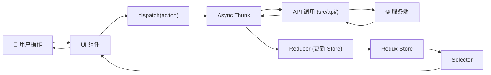
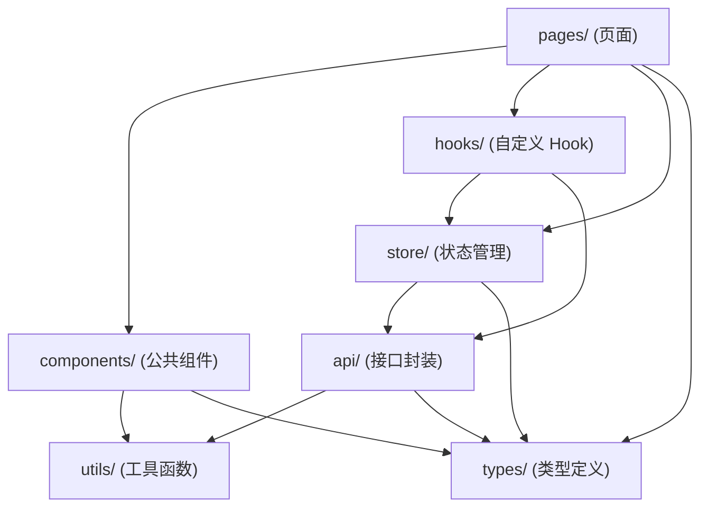

# 项目架构

## 整体架构风格

- **架构类型**：[SPA（单页应用）/ SSR（服务端渲染）/ 多入口 SPA / 微前端]
- **渲染方式**：[客户端渲染（CSR）/ 服务端渲染（SSR）/ 静态生成（SSG）]
- **部署方式**：[CDN 托管 / Node.js 服务 / 容器化]

## 设计模式

项目实际使用的设计模式（基于代码扫描结果）：

| 模式                         | 在项目中的体现                                       | 代码位置                          |
| ---------------------------- | ---------------------------------------------------- | --------------------------------- |
| **Container/Presentational** | 业务逻辑在 Container 组件，UI 在 Presentational 组件 | `src/pages/` vs `src/components/` |
| **Custom Hooks**             | 将有状态逻辑从组件中提取，便于复用和测试             | `src/hooks/`                      |
| **Provider Pattern**         | 跨组件共享数据（如主题、用户信息）                   | `src/providers/` 或 Context       |
| **Flux/Redux Pattern**       | 单向数据流，UI → Action → Reducer → Store → UI       | `src/store/`                      |

## 代码组织方式

```
按 [Feature-based（业务功能）/ Type-based（文件类型）/ 混合] 组织

[Feature-based 示例：]
src/
├── pages/
│   ├── home/            # 首页功能域
│   │   ├── components/  # 首页私有组件
│   │   ├── hooks/       # 首页私有 Hooks
│   │   └── index.tsx    # 首页入口
│   └── order/           # 订单功能域
│       └── ...
├── components/          # 跨域公共组件
└── store/               # 全局状态（跨域共享）
```

## 核心数据流



## 模块依赖关系



## 关键架构决策

> 记录重要的技术选型理由，帮助理解为什么这样设计

| 决策        | 选择              | 理由                                        |
| ----------- | ----------------- | ------------------------------------------- |
| 状态管理    | [RTK]             | [TypeScript 友好，内置 Immer，异步处理规范] |
| 路由方案    | [React Router v6] | [嵌套路由支持好，Hooks API 易用]            |
| 样式方案    | [CSS Modules]     | [局部作用域，避免样式污染，构建时优化]      |
| HTTP 客户端 | [Axios]           | [拦截器机制完善，请求取消支持好]            |

## 多入口/微前端架构（若适用）

> 仅适用于多入口或微前端项目

```
主应用 (main app)
├── 子应用A (sub-app-a)  →  [业务域A]
│   └── 独立路由前缀：/app-a/
├── 子应用B (sub-app-b)  →  [业务域B]
│   └── 独立路由前缀：/app-b/
└── 公共资源 (shared)
    ├── 共享组件库
    └── 共享状态（通过 [通讯方式] 共享）
```

- **通讯方式**：[CustomEvent / postMessage / 共享 localStorage / ...]
- **样式隔离**：[CSS prefix / Shadow DOM / BEM 约定]
- **路由协调**：[主应用路由代理 / 各子应用独立路由]
