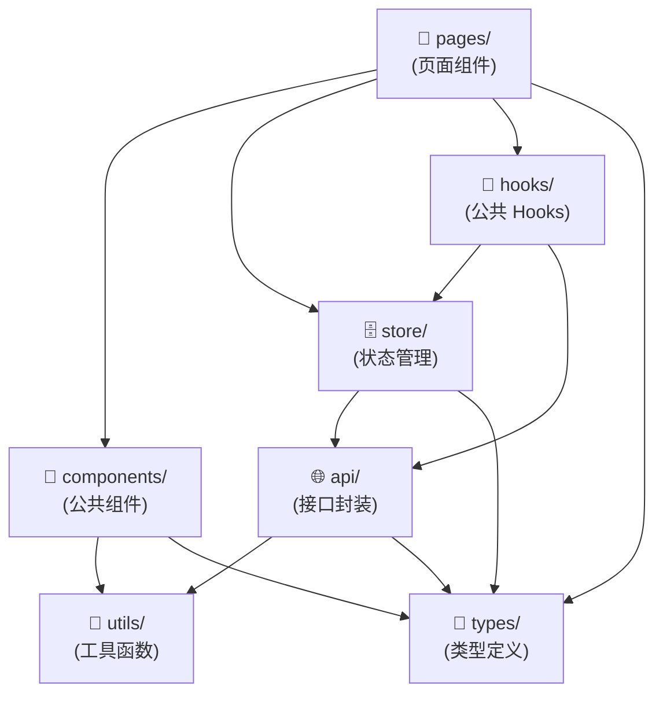

# 目录结构详解

## 目录树状图

```
[项目名称]/
├── src/                          # 主源码目录
│   ├── pages/                    # 页面组件（每个子目录对应一个路由）
│   │   ├── [page-name]/
│   │   │   ├── index.tsx         # 页面入口
│   │   │   ├── components/       # 页面私有组件
│   │   │   └── hooks/            # 页面私有 Hooks
│   │   └── ...
│   ├── components/               # 公共通用组件（≥2处复用）
│   │   └── [component-name]/
│   │       └── index.tsx
│   ├── api/                      # 接口封装（按业务域分文件）
│   │   ├── request.ts            # 请求实例（interceptors）
│   │   └── [domain].ts           # 各业务域接口
│   ├── store/                    # 全局状态管理
│   │   ├── index.ts              # Store 配置入口
│   │   └── [domain]-slice.ts    # 各业务域切片
│   ├── router/                   # 路由配置
│   │   └── index.ts
│   ├── hooks/                    # 全局公共 Hooks
│   ├── utils/                    # 工具函数（纯函数）
│   ├── types/                    # TypeScript 类型定义
│   ├── const/                    # 常量/枚举定义
│   ├── assets/                   # 静态资源（图片/SVG/字体）
│   └── styles/                   # 全局样式/主题变量
├── public/                       # 不需要构建的静态资源
├── mocks/                        # Mock 数据（开发阶段）
├── scripts/                      # 构建/工具脚本
├── [vite.config.ts]              # 构建工具配置
├── [tsconfig.json]               # TypeScript 配置
├── [.eslintrc.js]                # ESLint 配置
├── [.prettierrc]                 # Prettier 配置
└── package.json                  # 项目依赖与脚本
```

> ⚠️ 以上为通用结构示意，实际目录以扫描结果为准。

## 目录用途详细说明

### `src/pages/`

- **职责**：存放所有路由页面组件，每个子目录对应一个路由
- **规范**：目录名与路由路径对应，子目录可包含私有 `components/` 和 `hooks/`
- **禁止**：不得在 pages 中发起 HTTP 请求（应通过 store 间接调用）

### `src/components/`

- **职责**：存放跨页面复用的公共组件（≥2处使用）
- **规范**：每个组件独立目录，主文件为 `index.tsx`
- **命名**：目录使用 kebab-case，组件名使用 PascalCase

### `src/api/`

- **职责**：统一管理所有 HTTP 接口调用，按业务域拆分文件
- **规范**：`request.ts` 配置基础实例，各 `[domain].ts` 定义接口函数
- **禁止**：不得在此目录外直接调用 axios/fetch

### `src/store/`

- **职责**：全局状态管理，Redux Toolkit 切片按业务域拆分
- **规范**：`index.ts` 聚合所有 reducer，各 `[domain]-slice.ts` 独立维护
- **命名**：切片文件以 `-slice.ts` 结尾

### `src/hooks/`

- **职责**：存放跨页面复用的自定义 Hooks
- **区分**：页面私有 Hooks 放在对应 `pages/[page]/hooks/` 下

### `src/utils/`

- **职责**：纯函数工具库，无副作用，无 HTTP 调用，无状态
- **规范**：按功能分文件（format.ts/validate.ts/storage.ts 等）
- **测试**：工具函数应有对应单元测试

### `src/types/`

- **职责**：全局共享的 TypeScript 类型定义
- **规范**：只包含类型，不包含任何运行时代码

## 模块依赖关系图



> **依赖原则**：箭头方向 = 「被依赖方向」，上层依赖下层，严禁下层反向依赖上层（如 utils 不得 import store）。

## 特殊目录说明

| 目录       | 说明                                                             |
| ---------- | ---------------------------------------------------------------- |
| `public/`  | 直接复制到 dist 根目录，用于 favicon/manifest 等不需要构建的文件 |
| `mocks/`   | MSW / json-server 等 Mock 数据，仅开发环境使用                   |
| `scripts/` | 构建辅助脚本、代码生成脚本等，不参与应用构建                     |
| `envDir/`  | 环境变量文件目录（若不在根目录）                                 |
